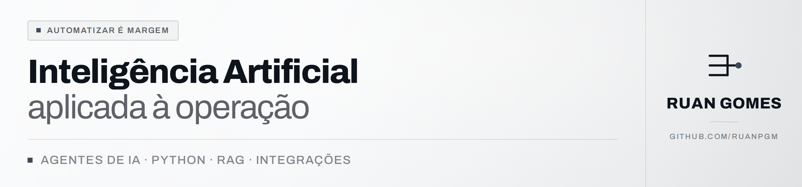
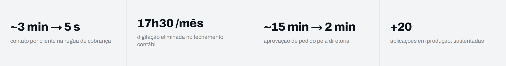
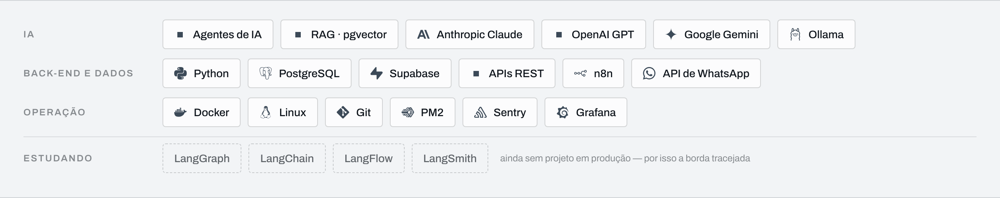
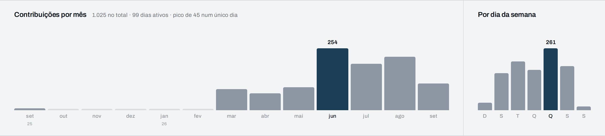

<picture>
  <source media="(prefers-color-scheme: dark)" srcset="./assets/header-dark.png">
  
</picture>

Construo sistemas de IA e automação que tiram trabalho manual da operação — e os mantenho rodando em produção.

Analista de TI Júnior na Diagonal Têxtil, indústria têxtil em Belo Horizonte. Desenvolvo e opero a plataforma interna de IA e automação, cobrindo comercial, financeiro, atendimento, estoque e TI. Comecei em banco de dados, passei por suporte, infraestrutura e ERP, e hoje desenho, implanto e sustento a solução ponta a ponta.

<picture>
  <source media="(prefers-color-scheme: dark)" srcset="./assets/impacto-dark.png">
  
</picture>

### O que está por trás desses números

- **Agente de IA com RAG** atendendo suporte N1 no chat corporativo, que abre chamado sozinho quando três tentativas não resolvem — conversa informal de corredor virou chamado registrado e mensurável
- **Régua de cobrança por WhatsApp**, com IA montando a abordagem e boleto anexado no fluxo — passou a cobrir a carteira inteira, não só a inadimplência grande
- **Integração ERP ↔ sistema contábil**, gerando o arquivo no layout exato que o contábil importa — acabou a redigitação lançamento por lançamento
- **PWA de pedidos com aprovação em campo** — o pedido e os indicadores de decisão chegam na mesma tela, no celular

### Projetos públicos

Os sistemas acima pertencem à empresa onde trabalho — código, schema e regra de negócio não saem de lá. O que está aqui são **reimplementações dos mesmos padrões**, com dados sintéticos, código que roda em um comando e as decisões técnicas documentadas. Os dois juntos contam a mesma coisa: saber quando usar IA, e quando não usar.

<a href="https://github.com/ruanpgm/erp-para-contabil">
<picture>
  <source media="(prefers-color-scheme: dark)" srcset="https://raw.githubusercontent.com/ruanpgm/erp-para-contabil/main/assets/fluxo-erp-dark.png">
  
</picture>
</a>

<a href="https://github.com/ruanpgm/rag-suporte-interno">
<picture>
  <source media="(prefers-color-scheme: dark)" srcset="https://raw.githubusercontent.com/ruanpgm/rag-suporte-interno/main/assets/fluxo-rag-dark.png">
  
</picture>
</a>

### Stack

<picture>
  <source media="(prefers-color-scheme: dark)" srcset="./assets/stack-dark.png">
  
</picture>

Python · PostgreSQL · Supabase (Edge Functions, pg_cron) · APIs REST · n8n · API de WhatsApp · agentes de IA · RAG com pgvector · Anthropic Claude · OpenAI GPT · Google Gemini · Ollama · grafos de conhecimento · engenharia de prompt · Docker · Linux · Git · PM2 · Sentry · Grafana · Zabbix · Power BI — estudando: LangGraph · LangChain · LangFlow · LangSmith

### Ritmo

<picture>
  <source media="(prefers-color-scheme: dark)" srcset="./assets/atividade-dark.png">
  
</picture>

A curva começa em março de 2026 — foi quando a plataforma de IA e automação saiu do papel. São 1.160 contribuições em 105 dias ativos no último ano, quase todas em dia útil: sábado e domingo somam 47.

Os números

| Mês | Contribuições | | Dia | Contribuições |
| --- | ---: | --- | --- | ---: |
| out/25 – fev/26 | 0 | | domingo | 31 |
| mar/26 | 86 | | segunda | 165 |
| abr/26 | 70 | | terça | 239 |
| mai/26 | 95 | | quarta | 199 |
| jun/26 | 254 | | quinta | 295 |
| jul/26 | 190 | | sexta | 215 |
| ago/26 | 219 | | sábado | 16 |
| set/26 | 213 | | | |
| out/26 (até 08/10) | 33 | | **total** | **1.160** |

Lido do próprio perfil em 08/10/2026. Inclui contribuições em repositório privado, de forma agregada — sem nome de repositório, como o GitHub também faz.

### Como eu decido o que automatizar

Procuro onde o processo sangra: a tarefa que alguém repete toda semana, o dado que três áreas calculam de três jeitos, a decisão que trava porque a informação mora em outro sistema. Uso LLM onde ela decide melhor que uma regra, e regra determinística onde IA seria desperdício.

  

